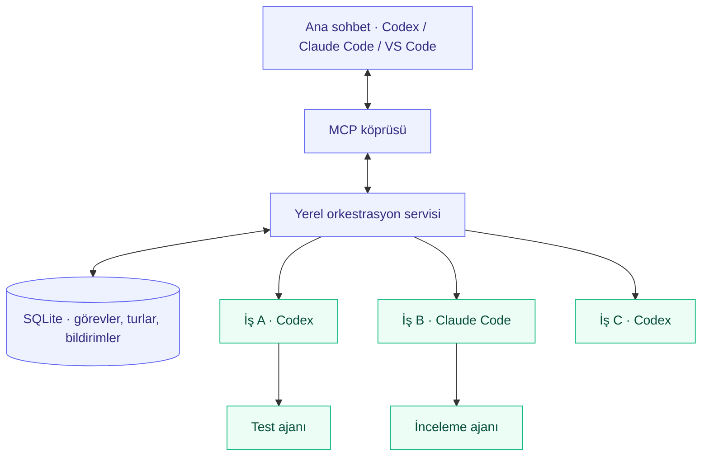

<div align="center">

# Standalone Agent Orchestrator

### Bir sohbet. Birden fazla ajan. Kontrol sizde.

Codex ve Claude Code için yerel, kalıcı ve iç içe alt ajan orkestrasyonu.
<br />
**MCP ile bağlanın. Görevleri dağıtın. Aynı oturumda devam edin.**

[](https://github.com/muratangin187/subagent-orchestrator/actions/workflows/test.yml)
[](https://github.com/muratangin187/subagent-orchestrator/releases/latest)
[](package.json)
[](src/mcp.ts)
[](LICENSE)

[Hızlı başlangıç](#hızlı-başlangıç) · [Nasıl çalışır?](#nasıl-çalışır) · [Araçlar](#mcp-araçları) · [Belgeler](#belgeler) · [Katkı](CONTRIBUTING.md)

<sub>Local MCP orchestration for Codex and Claude Code. Durable tasks, nested delegation, and explicit permission boundaries.</sub>

</div>

---

> “Bu üç işi incele. Her biri için bir alt ajan başlat. Gerekirse kendi test ajanlarını açsınlar. Ben ana sohbette devam ederken sonuçları topla.”

Bu proje, bu akışı MCP destekleyen bir istemciden yürütmenizi sağlar. Her görev kendi sağlayıcı oturumunu, tur geçmişini ve sonuçlarını korur. Ana sohbetten yeni bilgi gönderebilir, belirli bir sonucu bekleyebilir veya bütün bir alt ağacı iptal edebilirsiniz.

**T3 kurulumu, T3 hesabı veya T3 çalışma zamanı gerekmez.** Sağlayıcıların bilgisayarınızdaki CLI araçlarını ve mevcut girişlerini kullanır. Model çağrıları ilgili sağlayıcıya gider; orkestrasyon servisi ve görev kayıtları yereldir.

## Neler sunar?

| | Özellik | Ne işe yarar? |
| :--- | :--- | :--- |
| ↳ | **İç içe delegasyon** | İş ajanları kendi test, araştırma ve uygulama ajanlarını başlatabilir. |
| ⇄ | **İki sağlayıcı** | Codex ve Claude Code aynı görev ağacında çalışabilir. |
| ◷ | **Asenkron veya beklemeli** | Arka planda devam edin ya da belirli turun sonucunu bekleyin. |
| ↻ | **Aynı oturumda devam** | Yeni bilgiler, kuyruk mesajları ve desteklenen sağlayıcıda aktif yönlendirme. |
| ▣ | **Kalıcı kayıtlar** | SQLite üzerinde görevler, değişmeyen tur sonuçları, olaylar ve bildirimler. |
| ⎇ | **Worktree izolasyonu** | Bağımsız uygulama işleri için ayrı Git checkout'ları. |
| ⛨ | **İzin mirası** | Salt okunur varsayılan; çocuklar üst ajanın izin tavanını aşamaz. |
| ! | **Kota farkındalığı** | Kota/hız sınırı hatası, varsa yenilenme bilgisi ve bekletilen kuyruk. |

## Nasıl çalışır?



MCP köprüsünün kapanması görevleri durdurmaz; onları bağımsız yerel servis yönetir. Çocuk sonuçları doğrudan çağıran üst ajana döner. Varsayılan sınır **üç ajan katmanı**, **katman başına dört çalışan süreçtir**; ana sohbet katmana dahil değildir.

> [!IMPORTANT]
> Bildirimler kalıcıdır; ancak standart MCP her istemcide ana sohbeti kendiliğinden uyandıramaz. Üst ajan `get_notifications` çağırmalı veya `wait_for_task` ile beklemelidir. Ana sohbetin geçmişi ve diğer MCP araçları çocuklara otomatik aktarılmaz.

## Hızlı başlangıç

### 1. Gereksinimleri hazırlayın

- **Node.js ≥ 22.16** ve npm.
- macOS veya Linux. Yerel Windows desteği yok; WSL2 henüz doğrulanmadı.
- Kullanacağınız sağlayıcı için kurulu, giriş yapılmış CLI: `codex login` ve/veya `claude auth login`.
- Worktree kullanacaksanız Git ve en az bir commit içeren depo.

### 2. Paketi kurun

[v0.1.1 release](https://github.com/muratangin187/subagent-orchestrator/releases/tag/v0.1.1) paketini doğrudan kurabilirsiniz:

```sh
npm install -g https://github.com/muratangin187/subagent-orchestrator/releases/download/v0.1.1/standalone-agent-orchestrator-0.1.1.tgz
agent-orchestrator doctor
```

<details>
<summary><strong>Kaynak koddan kurmak istiyorum</strong></summary>

```sh
git clone https://github.com/muratangin187/subagent-orchestrator.git
cd subagent-orchestrator
npm ci
npm run build
npm pack
npm install -g ./standalone-agent-orchestrator-0.1.1.tgz
```

Paket henüz npm kayıt sisteminde yayımlanmadı. `npx standalone-agent-orchestrator` ile yayımlanmış bir paket indireceğinizi varsaymayın.

</details>

### 3. İstemcinize bağlayın

Örneklerdeki `/absolute/path/to/project` değerini kendi proje yolunuzla değiştirin. Varsayılan yetki **salt okunurdur**.

<details open>
<summary><strong>Codex</strong> · <code>~/.codex/config.toml</code></summary>

```toml
[mcp_servers.subagent_orchestrator]
command = "agent-orchestrator"
args = ["mcp", "--cwd", "/absolute/path/to/project"]
tool_timeout_sec = 75
```

</details>

<details>
<summary><strong>Claude Code</strong> · proje <code>.mcp.json</code> dosyası</summary>

```json
{
  "mcpServers": {
    "subagent_orchestrator": {
      "command": "agent-orchestrator",
      "args": ["mcp", "--cwd", "/absolute/path/to/project"]
    }
  }
}
```

</details>

<details>
<summary><strong>VS Code</strong> · <code>.vscode/mcp.json</code></summary>

```json
{
  "servers": {
    "subagent_orchestrator": {
      "type": "stdio",
      "command": "agent-orchestrator",
      "args": ["mcp", "--cwd", "/absolute/path/to/project"]
    }
  }
}
```

</details>

İstemcinizde MCP bağlantısını etkinleştirin ve oturumu/araç listesini yenileyin. Komut bulunamıyorsa `command` alanına `agent-orchestrator` dosyasının mutlak yolunu yazın. `agent-orchestrator config --cwd /absolute/path/to/project` bu örnekleri üretir; dosyalarınızı değiştirmez.

### 4. İlk görevi verin

Ana sohbetinize şunu yazın:

> subagent_orchestrator ile önce yetenekleri ve çalışma dizinini kontrol et. Codex ile bir mimari inceleme, Claude ile bir test kapsamı incelemesi başlat. Dosyaları değiştirmesinler. Sonuçları bekle, başarısızlıkları açıkça belirt ve bulguları birleştir.

**Her görev kendi başına anlaşılır bir brief almalıdır.** İlgili dosyaları, hedefi ve beklenen çıktıyı belirtin. Yalnızca kullandığınız sağlayıcının kurulu olması yeterlidir; iki sağlayıcılı bu örnek ikisini de gerektirir.

## Bir görevin yaşam döngüsü

Aşağıdakiler MCP araç çağrılarının giriş örnekleridir. `TASK_ID` ve `RUN_ID` yerlerine dönen gerçek UUID değerlerini kullanın.

**Başlat** · `delegate_task`

```json
{
  "task": "Kimlik doğrulama akışını incele. Dosyaları değiştirme. Üç somut risk ve ilgili dosya yollarını raporla.",
  "provider": "codex",
  "role": "review",
  "mode": "async",
  "clientRequestId": "auth-review-1"
}
```

**Bekle** · `wait_for_task`

```json
{ "taskId": "TASK_ID", "runId": "RUN_ID", "timeoutMs": 45000 }
```

Bekleme süresinin dolması iptal değildir. `taskId` konuşmayı, `runId` belirli bir turu tanımlar. Sonraki mesajın yeni turunu önceki tamamlanmış sonuçla karıştırmayın.

**Bağlamı güncelle** · `send_to_subagent`

```json
{
  "taskId": "TASK_ID",
  "message": "Yeni bilgi: eski giriş akışı kaldırılıyor. İncelemeyi yeni akışla sınırla.",
  "mode": "queue",
  "clientRequestId": "auth-review-update-1"
}
```

| Mesaj modu | Codex | Claude Code |
| :--- | :--- | :--- |
| `auto` | Aktif turu yönlendirir; boşta yeni tur | Aktifken kuyruğa alır; boşta yeni tur |
| `steer` | Aktif tura talimat ekler | Desteklenmez; açık hata döner |
| `queue` | Aktif turdan sonra yeni tur | Aktif turdan sonra yeni tur |
| `interrupt_and_restart` | Turu keser, aynı oturumda devam eder | Turu keser, aynı oturumda devam eder |

Aynı isteği ağ hatası sonrası tekrarlarken aynı `clientRequestId` ve içeriği kullanın. Yeni iş için yeni kimlik üretin. Sistem belirsiz sağlayıcı yan etkilerini otomatik tekrar etmez.

## MCP araçları

| Araç | Amaç |
| :--- | :--- |
| `orchestrator_capabilities` | Çalışma dizini, izin tavanı ve sağlayıcı yetenekleri |
| `delegate_task` | Alt ajan oluşturma; asenkron veya beklemeli çalışma |
| `send_to_subagent` | Aynı oturuma bağlam ve devam mesajı gönderme |
| `wait_for_task` | Belirli turu, tamamlanmayı veya yapılandırılmış soruyu bekleme |
| `get_task_status` | Durum, tur sonuçları, alt görevler ve teslim sorunları |
| `get_subagent_messages` | İmleçle konuşma ve araç olaylarını okuma |
| `get_notifications` | Tamamlanma, hata ve soru bildirimlerini okuma |
| `list_tasks` | Geçerli ana oturumun görevlerini listeleme |
| `answer_subagent` | Bekleyen yapılandırılmış soruya yanıt verme |
| `cancel_task` | Görevi ve alt ağacını iptal etme |

Olay ve bildirim okumalarında `nextOffset` değerini sonraki çağrının `sinceOffset` alanına taşıyın. Bildirimler okununca silinmez.

## Kontrol sizde

### Modeller ve CLI sürümleri

`model` alanına sağlayıcının kabul ettiği kimliği verin. Sistem desteklenmeyen bir modeli sessizce başka bir modelle değiştirmez. Alan boşsa kök görev sağlayıcının varsayılanını kullanır; aynı sağlayıcıdaki çocuk üst modelini devralır.

```sh
agent-orchestrator models     # Çalışan servisin Codex model kataloğu
agent-orchestrator doctor     # Kabuktaki CLI kurulumları ve sürümleri
```

Birden fazla CLI kurulumu varsa `ORCHESTRATOR_CODEX_BIN` veya `ORCHESTRATOR_CLAUDE_BIN` ile mutlak yol seçebilirsiniz. Model kataloğu, ana uygulamanızın kataloğuyla aynı olmayabilir. [CLI yolu sorun giderme →](docs/usage.md#yanlış-cli-sürümü-veya-model-görünmüyor)

### İzinler ve worktree

| İzin tavanı | Davranış |
| :--- | :--- |
| `read-only` | Varsayılan. Codex salt okunur sandbox; Claude okuma/arama/soru araçları. |
| `approval-required` | Bu sürümde salt okunur davranır; etkileşimli yetki yükseltme yok. |
| `auto-accept-edits` | Codex çalışma dizinine yazabilir, ağ kapalıdır. Claude proje içi Write/Edit kullanır, kabuk kullanamaz. |
| `full-access` | Açık tercih gerekir. Codex sandbox kısıtı kalkar; Claude kabuk ve yazma araçlarını alır. |

Yazma izni için MCP argümanlarına `--ceiling auto-accept-edits` ekleyin. Tavanı ana oturumun gerçek izinlerinden geniş tutmayın. Çocuklar bu tavanı yükseltemez; `--plan` salt okunur çalışmayı zorlar.

Bağımsız uygulama görevlerinde `isolation: "worktree"` seçin. Ayrı checkout, görev kabulündeki commit'ten oluşturulur. Kaydedilmemiş değişiklikler kopyalanmaz; bağımlılıklar otomatik kurulmaz. Worktree'ler incelemeniz için korunur; otomatik merge veya silme yapılmaz.

### Kota ve kesinti

- **Kota dolduğunda:** Görev `failed` olur. Üst ajana `usage_limit` veya `rate_limit`, sağlayıcı ve varsa `resetHint` gider. Sıradaki mesajlar bekletilir; otomatik tekrar yapılmaz.
- **Servis çöktüğünde:** Belirsiz aktif işler `recovery_required` olur. Önce kayıtları ve dosyaları inceleyin; sonra açık devam mesajı gönderin.
- **Köprü kapandığında:** Servis ve görevler çalışmayı sürdürür. Sohbeti kapatmayı iptal olarak kabul etmeyin.

```sh
agent-orchestrator status
agent-orchestrator stop       # Bu veri alanındaki bütün aktif sağlayıcı süreçlerini durdurur
```

Tek görevi durdurmak için `cancel_task` kullanın. Görev geçmişi varsayılan olarak `~/.local/share/agent-orchestrator/` altında kalır.

<details>
<summary><strong>Oturuma yeniden bağlanma ve kapasite ayarları</strong></summary>

Her MCP köprüsü varsayılan olarak farklı ana oturum kimliği üretir. Önceki işlerinize yeniden bağlanmak için `orchestrator_capabilities` çıktısındaki `scope.id` değerini `--parent` argümanı olarak saklayın. Aynı kimliği bağımsız sohbetlere ortak vermeyin.

Servis başlamadan önce `ORCHESTRATOR_MAX_DEPTH` (1–8, varsayılan 3) ve `ORCHESTRATOR_CONCURRENCY_PER_DEPTH` (1–16, varsayılan 4) ayarlanabilir. İlk köprünün başlattığı servis ortamı korur; değişiklik için aktif işleri güvenli biçimde bitirip servisi yeniden başlatın.

Aynı çalışma dizinindeki yazabilen görevler sırayla çalışır. Yazan üst ajan aynı dizindeki yazan çocuğunu beklemeli veya ayrı worktree kullanmalıdır. Üst ajanların beklemesi diğer derinliklerin işlem yuvalarını tüketmez.

</details>

## Sınırlar ve güvenlik

> [!NOTE]
> Bu sürüm geliştirici aracıdır; görsel görev paneli henüz yoktur. Görevleri MCP araçlarıyla inceleyebilirsiniz.

- Yerel işletim sistemi kullanıcısı güven sınırıdır; çok kiracılı servis veya düşman kod sandbox'ı değildir.
- Konuşma ve görev verileri diskte tutulur; şifreleme ve otomatik silme yoktur.
- Çocuklar ana konuşmayı veya ana ajanın diğer MCP bağlantılarını otomatik devralmaz.
- Sağlayıcı hesap kotaları ve ücretleri geçerlidir. Model harcama üst sınırı uygulanmaz.
- Bir tur en fazla 30 dakika; en fazla 1.000 açık görev ve görev başına 100 kuyruk mesajı.
- Girdi 64.000, saklanan sonuç 128.000 karakterle sınırlıdır.
- Gerçek sağlayıcı testleri macOS'ta yapıldı. Linux/WSL üzerinde gerçek model testi iddia edilmiyor; CI durumu yukarıdaki rozette görünür.

Ayrıntılar: [güvenlik politikası](SECURITY.md) · [izinler ve veri yaşam döngüsü](docs/usage.md#bilinen-sınırlar).

## Geliştirme

```sh
npm ci
npm run format:check
npm run check
npm test
npm run build
```

**34 otomatik test:** görev yaşam döngüsü, iç içe delegasyon, izinler, kota bildirimleri, süreç çökmesi, kalıcı kayıtlar, MCP bağlantısı ve worktree davranışı. Normal testler model hesabı veya API anahtarı istemez.

<details>
<summary><strong>Gerçek sağlayıcı testleri</strong></summary>

```sh
npm run test:live
npm run test:live:controls
npm run test:live:nesting
```

Bu komutlar mevcut sağlayıcı girişlerinizi kullanır ve kota tüketebilir. Geçici çalışma dizinlerinde çalışırlar. Önceki başarılı senaryolar, kota nedeniyle tamamlanamayan tekrarlar ve doğrulanan sürümler [doğrulama kaydında](docs/verification.md) ayrı belirtilir.

</details>

## Belgeler

| Rehber | İçerik |
| :--- | :--- |
| [Ayrıntılı kullanım](docs/usage.md) | Kurulum, oturum kimliği, mesaj semantiği, izinler ve sorun giderme |
| [Mimari kararlar](docs/architecture.md) | Katmanlar, veri güvenilirliği ve tasarım tercihleri |
| [Doğrulama kaydı](docs/verification.md) | Otomatik ve gerçek sağlayıcı testlerinin kanıtları ve sınırları |
| [Sürüm notları](CHANGELOG.md) | Sürümler arasındaki değişiklikler |
| [Katkı rehberi](CONTRIBUTING.md) | Yerel geliştirme ve pull request hazırlama |
| [Güvenlik](SECURITY.md) | Güven sınırları ve özel açık bildirimi |

## Yol haritası

Gelecekte görev ağacını, konuşmaları ve olayları incelemek için görsel bir arayüz hedefleniyor. Mevcut servis ve kayıt yapısı buna temel olacak. Bu bir teslim tarihi veya mevcut özellik vaadi değildir.

## Katkı ve kaynaklar

Hata raporları ve somut iyileştirme önerileri için [issue açın](https://github.com/muratangin187/subagent-orchestrator/issues). Kod katkısı için [katkı rehberini](CONTRIBUTING.md) izleyin. Güvenlik açıklarını public issue yerine [özel olarak bildirin](https://github.com/muratangin187/subagent-orchestrator/security/advisories/new).

Tasarım sırasında [T3 Code](https://github.com/pingdotgg/t3code) orkestrasyon yaklaşımı incelendi. İncelenen sürüm ve kaynaklar [mimari belgesinde](docs/architecture.md) listelenir. T3 çalışma zamanı kodu veya paket bağımlılığı bu projeye taşınmadı.

---

<div align="center">

**[MIT lisansı](LICENSE)** · Yerel orkestrasyon, açık kaynak.

</div>
